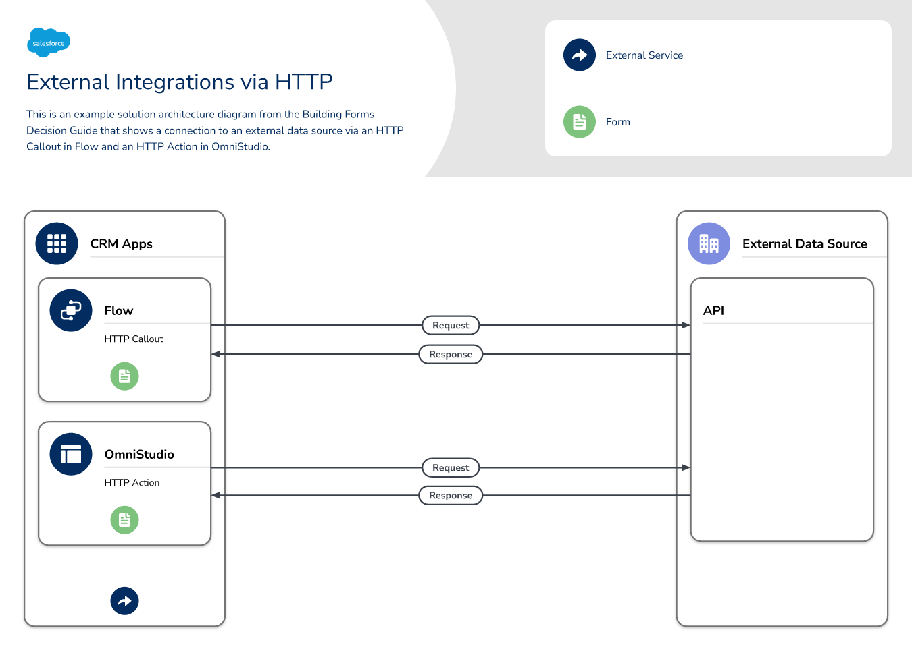
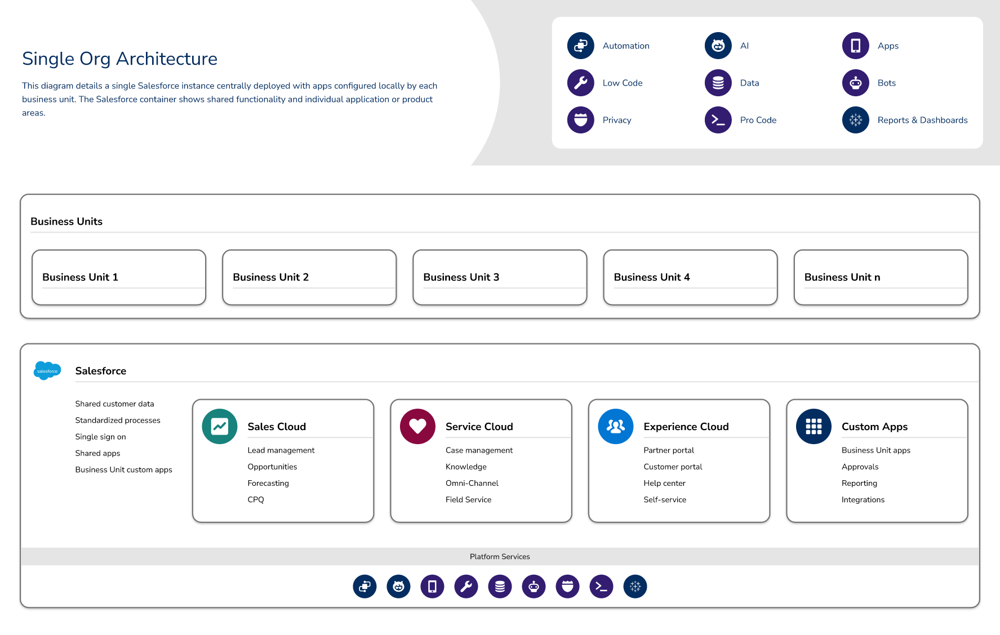
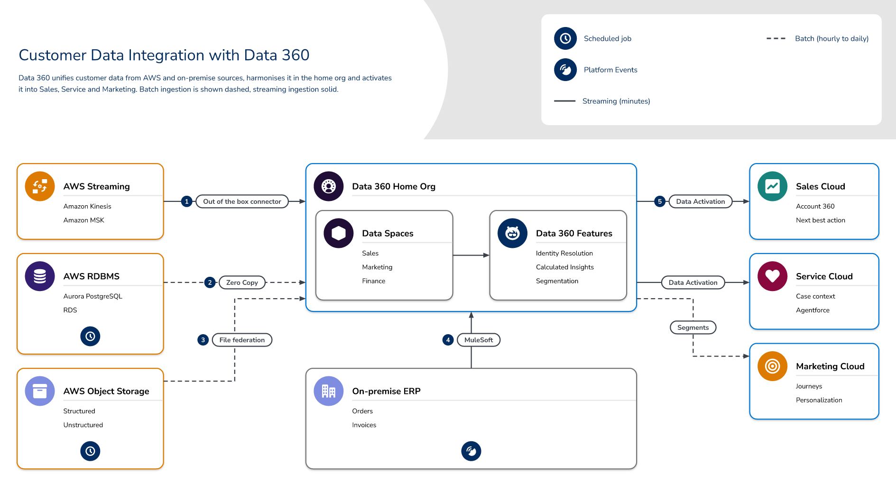
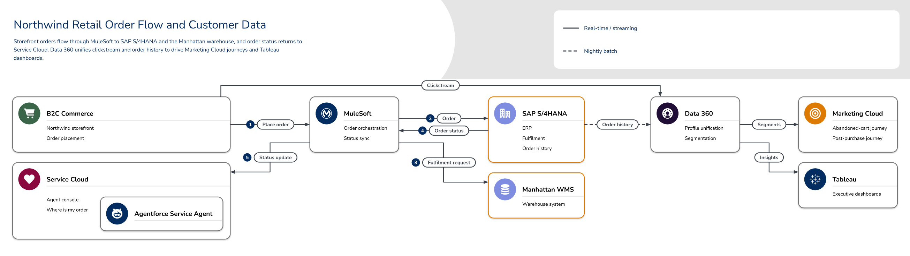
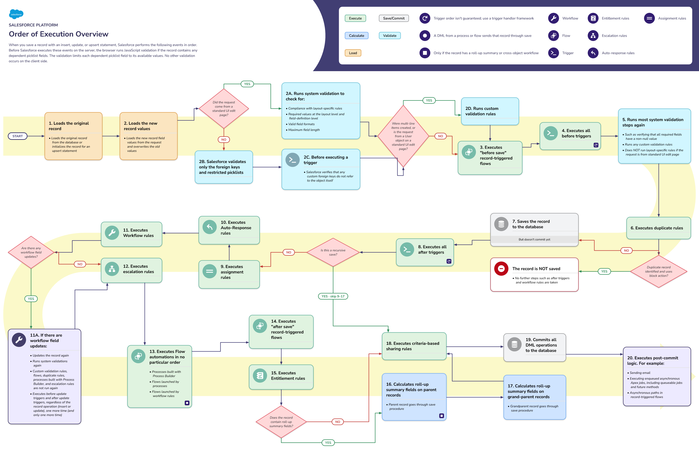
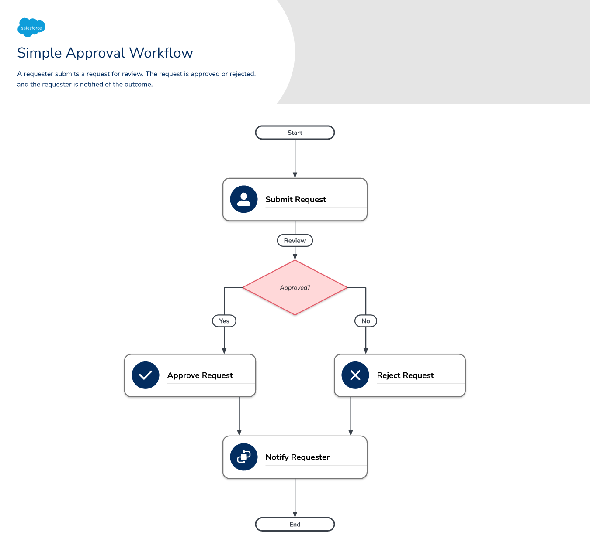
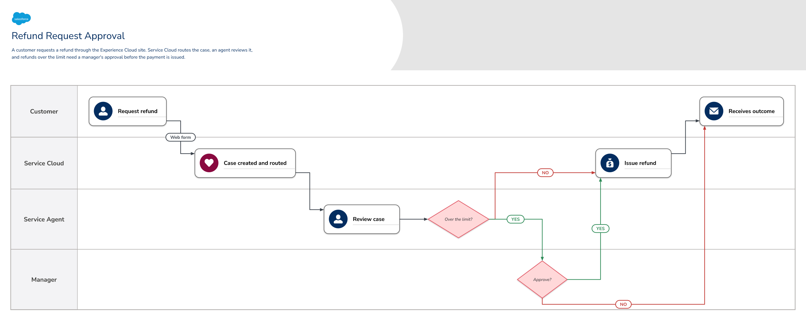

# sfdiag — Salesforce Well-Architected diagrams as code

Write Salesforce architecture diagrams as a short YAML file and get output that looks
like the hand-built Lucidchart diagrams in the
[Salesforce Architects reference gallery](https://architect.salesforce.com/diagrams).
That means the header with its arc and key, rounded cards with icon circles and title
rules, nested containers, elbow connectors with pill labels, and numbered steps.

- **Versionable:** the diagram is text, so it diffs, reviews and merges in git like code.
- **On-brand by construction:** you describe *what* is there; colours, typography,
  spacing, icon treatment and connector routing come from tokens measured off the
  official diagrams.
- **AI-friendly:** a small, strict schema with machine-readable validation errors
  (path, line, "did you mean…" hints), plus a Claude skill that runs the
  write → validate → render → look → fix loop.
- **Lucid when you need it:** export to Lucid Standard Import (`.lucid`) to keep
  editing in Lucidchart.



```yaml
title: External Integrations via HTTP
description: >-
  This is an example solution architecture diagram from the Building Forms Decision
  Guide that shows a connection to an external data source via an HTTP Callout in
  Flow and an HTTP Action in OmniStudio.
logo: salesforce
layout: row
nodes:
  - id: crm
    title: CRM Apps
    icon: crm-apps
    layout: column
    footerIcons: [external-service]
    children:
      - { id: flow, title: Flow, icon: flow, attributes: [HTTP Callout], footerIcons: [form] }
      - { id: omni, title: OmniStudio, icon: omnistudio, attributes: [HTTP Action], footerIcons: [form] }
  - id: external
    title: External Data Source
    icon: building
    children:
      - { id: api, title: API, height: 260 }
connections:
  - { from: flow, to: api, label: Request }
  - { from: api, to: flow, label: Response }
  - { from: omni, to: api, label: Request }
  - { from: api, to: omni, label: Response }
```

## Quick start

```sh
npm install
npm run build
npx sfdiag render examples/single-org-architecture.yaml --png   # → .svg + .png beside the YAML
npx sfdiag validate examples/*.yaml --json                      # CI / LLM friendly
npx sfdiag export-lucid examples/data360-integration.yaml       # → .lucid for Lucidchart
npx sfdiag catalog                                              # icon ids
npx sfdiag schema > sfdiag.schema.json                          # JSON Schema (editor completion)
```

During development, run `npx tsx src/cli.ts …` in place of `npx sfdiag …`.

## Writing diagrams

The full format reference is in [the authoring skill](.claude/skills/sf-diagram/SKILL.md),
which is the same document Claude uses. The essentials:

| Concept | YAML |
|---|---|
| Card | `{ id, title, icon?, attributes?, footer?, footerIcons? }` |
| Container | a card with `children`, arranged with `layout: row \| column \| grid` |
| Invisible group | `frame: none` (used to build columns and rows) |
| Connector | `{ from, to, label?, style: solid\|dashed\|dotted, arrow?, step? }` |
| Vendor/zone colour | `color: orange` on cards or connectors |
| Key | automatic (footer icons and non-solid line styles); rename entries with `keyLabels` |
| Flowchart shapes | `shape: decision \| pill \| note`, categories via `classes`, `reverse: true` rows, `road` |
| Line things up | `alignWith: <id>` levels a node with another so the line between them is straight |
| Roadmap | `timeline:` with periods across, lanes down and cards spanning dates |
| Swimlanes | `swimlanes:` with one lane per actor and steps at sequence positions (`at`) |
| Header | `header: { eyebrow, bold, logoPosition: side, titleSize, italicDescription }`, `keyTitle`, `keyOrder` |

Layout is a nest of rows, columns and grids, so authors (human or LLM) never place
coordinates. Connectors are routed orthogonally around cards. Gaps widen
automatically to fit labels, parallel connectors between the same cards are spread
out and drawn straight, and lines that would have to cross a row of cards go over the
top instead. A decision branching down to cards on either side leaves from its left and
right points.

### Using it with Claude

The repository ships a project skill at `.claude/skills/sf-diagram`. Describe the
architecture in plain English ("orders go from B2C Commerce via MuleSoft to SAP…") and
Claude writes the YAML, validates it, renders it, looks at the PNG and refines it. To
use the skill in another repository, copy the folder into that repo's `.claude/skills/`.

## Examples

| | |
|---|---|
|  |  |





`examples/order-of-execution.yaml` recreates the Salesforce Platform *Order of Execution*
flowchart: categories (`classes`), decision diamonds, YES/NO paths, a right-to-left middle
row and the winding road.

`examples/northwind-retail.yaml` was written by an LLM from a one-paragraph description
using only the skill, with no validation errors and two render rounds.



`examples/approval-workflow.yaml` is a minimal flowchart: start/end pills, a decision and
yes/no branches, with no routing hints.



`examples/refund-approval-swimlane.yaml` is a swimlane process: one lane per actor, steps
at sequence positions, decisions branching across lanes. Add `orientation: vertical` to
run the lanes as columns.

### Reference gallery recreations

`examples/gallery/` holds 20 recreations of diagrams from the
[Architects reference gallery](https://architect.salesforce.com/diagrams): system
landscapes, solution architectures and process flows, event-driven patterns, capability
maps, roadmaps and a release plan. Render any of them with
`npx sfdiag render examples/gallery/<name>.yaml --png`.

## Fidelity notes

- **Measured tokens:** colours, stroke widths, radii, spacing and type sizes were
  sampled from the official reference PNGs (see `src/theme.ts`).
- **Icons:** white [SLDS](https://www.lightningdesignsystem.com/icons/) utility glyphs
  on coloured circles, which is how the official diagram icon set is built. They come
  from the `@salesforce-ux/icons` npm package (CC BY-ND 4.0) and are composed but not
  modified. To use the official Lucid shape-library artwork, put `<icon-id>.svg` files
  in an `icons/` folder next to your YAML (or pass `--icons <dir>`). Local files
  override catalogue ids, and `slds:<name>/<colour>` gives you any other SLDS glyph.
- **Font:** the official diagrams use Salesforce Sans, which can't be redistributed.
  The bundled substitute is **Nunito Sans** (SIL OFL; name table normalised), the
  closest open humanist match in width and shapes. If you have Salesforce Sans, pass
  `--fonts <dir>` with its Regular/SemiBold/Bold TTFs.
- **SVG text:** `--text embed` (the default) embeds the fonts so the SVG renders
  identically anywhere. `--text paths` converts text to outlines, and `--text plain`
  references the font by name only.

## Lucid export

`sfdiag export-lucid` writes a Lucid Standard Import zip with:
- native rounded rectangles, text, rule and footer shapes;
- PNG icons;
- elbow lines attached to the card shapes, with pills and step badges grouped with
  their line.

Each card's parts are grouped together. Import it through the Lucid REST API
(`POST /documents` with `x-application/vnd.lucid.standardImport`).

Known gaps:
- Lucid re-routes elbow lines itself, so exact bends may differ from the SVG.
- Drop shadows are not exported.
- The fallback font is substituted in Lucid.

## Development

```sh
npm test          # vitest: schema, validation, layout & routing invariants, render, Lucid
npm run typecheck
node scripts/glyph-sheet.mjs out.png "flow,data_cloud,tableau"   # preview SLDS glyphs
```

Source map: `schema.ts` (format), `validate.ts` (errors and hints), `catalog.ts`
(icons), `text.ts` (font metrics), `layout.ts` (boxes), `timeline.ts` (roadmaps),
`swimlane.ts` (swimlanes), `route.ts` (connectors and labels), `render.ts` (SVG), `png.ts` (resvg), `lucid.ts` (Lucid export), `cli.ts`.

Supported: System Landscape and Solution Architecture diagrams, capability maps,
roadmaps and release plans (Architects gallery style, see `examples/gallery/`), and
process flowcharts with decisions, categories and snake layouts (developer-docs style,
see `examples/order-of-execution.yaml`), and swimlane process flows (horizontal or
vertical lanes, see `examples/refund-approval-swimlane.yaml`). Data models are not
covered yet.
